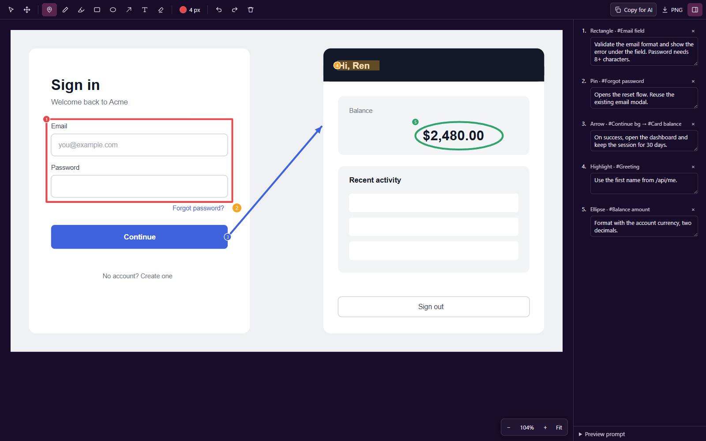

# SVG Annotate

Point at a design and tell your AI agent what to build, without Figma MCP.



## Use it

1. In Figma, select an artboard or a page and export it as SVG. In the export settings turn on
   **Include "id" attribute** (layer names become ids the AI can find) and turn off
   **Outline text** (text stays text).
2. Open the `.svg` in Orca and switch the file's tab from **Source** to **SVG Annotate**.
3. Mark the design. After each mark a box opens beside it: type what should happen there and
   press Enter (Esc skips; select a mark and press Enter to edit its note later).
4. Click **Copy for AI** and paste into your agent. **PNG** saves the design with your marks,
   for agents that take images.

Each note keeps the layer ids under the mark (`#Card > #Button`), its position in the design
and your text. The notes are also saved inside the SVG, in `<metadata id="ai-annotations">`, so
an agent that opens the file can read them too. Clearing every mark leaves the SVG as exported.

Try it on [examples/sign-in-flow.svg](examples/sign-in-flow.svg).

## Tools

| Tool | Key | |
| --- | --- | --- |
| Select | V | Pick a mark and drag it; Delete removes it |
| Pan | H | Or hold Space and drag |
| Pin | I | Click a spot |
| Pen | P | Draw freehand |
| Highlight | L | Wide translucent stroke |
| Rectangle | R | Drag a box |
| Ellipse | O | Drag an oval |
| Arrow | A | Drag from one layer to another, e.g. "this button opens that screen" |
| Text | T | Click and type text onto the design |
| Eraser | E | Click or drag over marks |

Ctrl+wheel (or pinch) zooms, `+` `-` zoom, `0` fits, `1` is 100%. Ctrl+Z and Ctrl+Shift+Z undo and
redo. `\` shows or hides the notes panel. The color and width button sets the next mark's color,
stroke width and text size.

## Limits

- Copy for AI copies the prompt as text. Orca's plugin frames cannot put images on the
  clipboard, so use PNG for the picture.
- Orca does not tell the editor the file's path, so tell your agent which SVG you mean if it
  should open the file itself.

## Develop

```sh
orca plugin validate .
orca plugin dev watch .    # loads this folder into Orca; prints the --approve fingerprint
```
